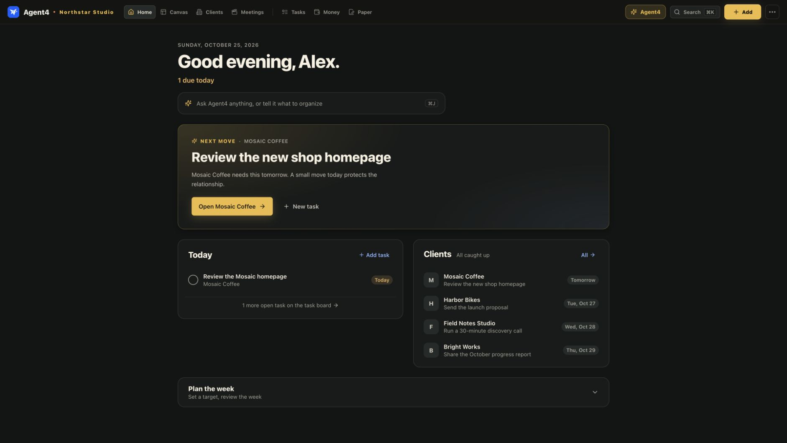
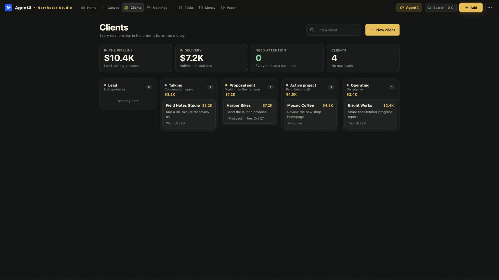
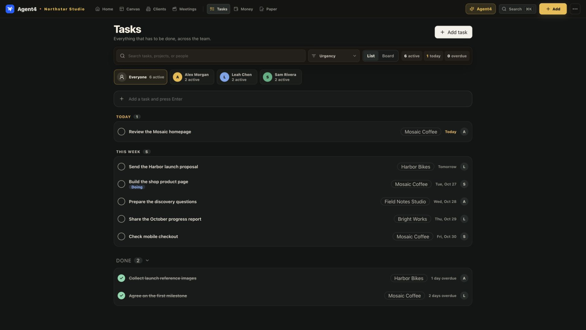
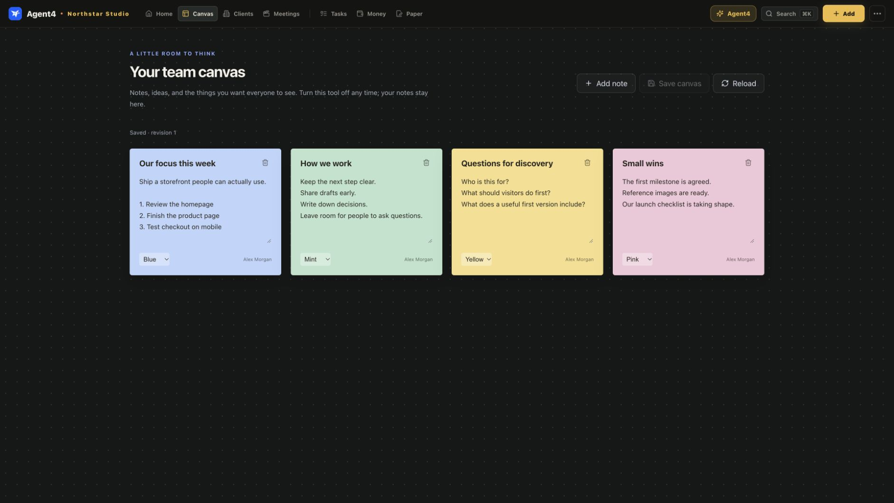

<div align="center">
  
  <h1>Agent4</h1>
  <p><strong>An open-source workspace for running a small company.</strong></p>
  <p>Clients, projects, tasks, meetings, and money. On your own server.</p>
  <p>
    <a href="https://github.com/TheRealShamsaba/agent4-community/actions/workflows/ci.yml"></a>
    <a href="https://github.com/TheRealShamsaba/agent4-community/actions/workflows/codeql.yml"></a>
    <a href="LICENSE"></a>
  </p>
</div>

Agent4 gives a small team one place to organize the work of building a company. Track a potential client, turn the relationship into a project, assign the next task, keep meeting notes, and follow the money without maintaining a separate tool for each step.

It is built for founders, independent studios, and small teams who want a useful starting point they can own and change. **The core tools are free to use and self-host.** There are no per-seat fees or required AI subscriptions. You pay for the hardware, hosting, and optional services you choose.



*Actual app screenshots at 1920 × 1080. Northstar Studio, its people, clients, and work are fictional examples created for this documentation. New installations start empty.*

[What's included](#whats-included) · [Install](#install-agent4) · [Your first workspace](#your-first-workspace) · [Customize](#make-it-fit-your-team) · [Hosting & backups](#hosting-updates-and-backups) · [Contribute](#contribute)

## What's included

| Tool | Use it to |
| --- | --- |
| **Home** | See work due today, choose the next useful action, and plan the week. |
| **Clients** | Track leads, conversations, proposals, active projects, and ongoing relationships. Keep a next step and date for each client. |
| **Projects** | Keep a project's goal, owner, milestones, decisions, links, discovery sheets, and files with its client. |
| **Tasks** | Assign work to teammates, add dates and comments, and follow progress in a list or board. |
| **Meetings** | Keep personal recordings, transcripts, notes, and reviewed action items. Transcription and AI summaries use optional services. |
| **Money** | Record income and expenses, track recurring costs, and create invoices. Currency totals stay separate. Owner only. |
| **Paperwork** | Draft proposals, agreements, updates, and receipts using editable templates. Owner only. |
| **Canvas** | Keep shared notes, ideas, and questions on a simple team wall. Optional. |
| **Sites** | Monitor public website availability and search basics; optionally collect visitor and error events. Owner only; off by default. |
| **Agent4 assistant** | Ask built-in questions about your work. Add a local or hosted model for open-ended conversations and suggested actions you review before applying. |

You can start with just Clients and Tasks. Turn on the other tools when you need them. **Hiding a tool preserves its saved work**, so you can bring it back later.

### From a client conversation to work getting done

Add a client, choose their stage, and record the next action. Open their workspace to create a project, collect discovery answers, attach files, and keep decisions together. Link tasks to the client and give each task an owner and a date.

The Clients view shows where each relationship stands and which follow-up comes next:



Tasks bring work from different clients into one team view. Filter by teammate, switch between List and Board, open a task to discuss it, and mark it complete when it is finished:



## Install Agent4

### Docker — recommended

You need **Git** and **Docker with Compose v2**. Start Docker Desktop on your laptop, or Docker Engine on a server. Run these commands in a shell on macOS, Linux, or WSL2:

```sh
git clone https://github.com/TheRealShamsaba/agent4-community.git
cd agent4-community
./agent4.sh
```

The first build can take a few minutes. The installer builds the app, starts it, waits until it is healthy, and prints a **private setup link**.

1. Open that link in your browser.
2. Enter your workspace name, name, email, and a password of at least 12 characters.
3. Create your owner account. You are ready to add your own work.

Agent4 runs at **[http://localhost:8782](http://localhost:8782)** by default. The port is accessible from your machine only. There are no default login credentials, sample clients, or preconnected company accounts. Setup closes after the first owner is created.

Keep the setup link private. If you open the address directly and the form asks for a setup key, use the link or key printed in your terminal.

**Hosting for a remote team?** Follow the [HTTPS hosting guide](docs/SELF_HOSTING.md#https-for-a-remote-team) to configure your domain and reverse proxy before sharing access.

<details>
<summary><strong>Run with Node instead of Docker</strong></summary>

Use **Node 24 LTS**, or Node 22.13+ on the 22.x line. SQLite is included in Node; no separate database service is required.

```sh
npm ci
npm --prefix hq ci
npm run hq:build
npm run setup
npm start
```

`npm run setup` prints your private first-use link. Open it after the server starts. Native installs bind to `127.0.0.1` by default. For local AI, set `OLLAMA_BASE_URL=http://127.0.0.1:11434` in `.env` if you choose to use Ollama.

See [CONTRIBUTING.md](CONTRIBUTING.md#run-locally) for the frontend development server.

</details>

## Your first workspace

Start small. You do not need to configure every feature before using Agent4.

1. **Choose your tools.** Open the top-right menu → **Team access → Customize this workspace**. Set your company name and turn on the tools you need. Canvas and Sites start off; the other tools start on.
2. **Add your first client.** Open **Clients → New client**. Give the relationship a stage, next action, and follow-up date.
3. **Create a project.** Open that client and add a project. Write down what you want to achieve, who owns it, and the next milestone.
4. **Add real next steps.** Open **Tasks → Add task**. Set an assignee, client, and due date. Use the team filters to see each person's workload.
5. **Invite your team.** In **Team access**, enter a teammate's name and email. Copy the invitation link and send it to them privately. They choose their own password.

Agent4 does **not** send invitation emails or require a mail server. Invitations work once, expire after seven days, and can be revoked. Reissuing an invitation for the same email replaces the previous unused link. Removing a teammate revokes their sessions; the owner account is protected from removal.

For daily use, begin on **Home**, review today's tasks and client follow-ups, then open the relevant client or task to continue. Use **Search** in the top bar to find work across the workspace. Open **Agent4** to ask a question or request a proposed action.

### What your teammates can see

One installation is one trusted team, with shared work and personal areas:

| Access | Records |
| --- | --- |
| **Shared with the team** | Clients, projects, tasks, shared files and Canvas notes. |
| **Personal to the signed-in account** | Calendar events and meeting recordings/notes. Private browser drafts are scoped to their account. |
| **Owner only** | Money, invoices, paperwork, site monitoring, invitations, member removal, and workspace settings. |

Permissions are enforced by the server. Turning a module off changes navigation; it does not revoke someone's existing permission to access its retained records through the API.

## Make it fit your team

Agent4 is a starting point you can adapt to how your company works.

- **Choose the visible tools** in **Team access → Customize this workspace**. You can hide Canvas today and restore it next month; its notes stay saved. The choices apply to everyone in that installation.
- **Use your own identity.** Set your workspace name and invoice details. Replace the falcon, change colors, and adapt the interface in the source.
- **Change your documents.** Edit the paperwork and discovery-sheet templates for the work you actually do.
- **Build on the code.** Add tools and optional connections, or contribute reusable improvements to the public core.

Here is the optional Canvas with shared planning notes:



The [customization guide](docs/CUSTOMIZATION.md) points to the relevant source files. The [architecture guide](docs/ARCHITECTURE.md) explains how to keep your deployment's private configuration separate while updating the shared core.

## AI and other optional services

**You can use the workspace without an AI model, Telegram, Google, or GitHub credentials.** Add a connection only when it solves a need for your team.

| If you want… | Configure… |
| --- | --- |
| Open-ended assistant conversations and generated notes | Your own Ollama endpoint and model, or a supported hosted model with your API key. |
| Audio transcription | A whisper.cpp-compatible HTTP transcription service; explicitly enable transcription in `.env`. |
| Repository activity inside a project | A GitHub token limited to the repositories you choose. |
| A Telegram mini app and optional notifications | Your own Telegram bot, linked accounts, and an HTTPS deployment. |
| Client-facing updates or a website inquiry form | The optional client-page/inquiry settings and your own domains. |

Built-in assistant answers work without a model. Transcription and generated meeting summaries need their respective services. Google Calendar connector code is included for developers; entering OAuth credentials does not enable automatic web-UI sync.

The [integration guide](docs/INTEGRATIONS.md) explains configuration, requirements, and what data each connection sends to its chosen service. Credentials stay in your ignored `.env` file, outside the public source.

## Hosting, updates, and backups

The default installation uses one application container and a persistent Docker volume. Start with approximately **2 CPU cores and 2 GB RAM**, plus storage for your files and audio. Building the image needs additional temporary resources. AI inference and transcription need their own hardware or service capacity.

| Keep track of | Location |
| --- | --- |
| Deployment URL, timezone, optional credentials | `.env` on your host; never commit it. |
| Database, uploaded documents, meeting audio, backups | Persistent Docker volume, named `agent4_agent4-data` for the default Compose project. |
| First-owner setup key | `.secrets/setup-token` on your host; never share it publicly. |
| App code and editable templates | This repository. |

Common commands:

```sh
./agent4.sh                 # Start or rebuild; preserve workspace data
./agent4.sh stop            # Stop; preserve workspace data
./agent4.sh logs            # Read recent application logs
./agent4.sh backup          # Briefly stop, back up database + files, restart
./agent4.sh reset-password  # Recover an account from the host terminal
```

To copy backups out of the container:

```sh
docker compose cp agent4:/app/data/backups ./backups
```

Keep the **whole backup directory** in private storage outside the server. Backups include private workspace records. Do not run `docker compose down -v` unless you intend to delete the workspace volume.

To update an installation you use:

```sh
./agent4.sh backup
git pull --ff-only
./agent4.sh
```

Read the [changelog](CHANGELOG.md) before updating. Follow the [hosting guide](docs/SELF_HOSTING.md) for HTTPS, custom ports, recovery, and restoring a backup into a new volume. This is an early community release; test upgrades on a backup before relying on them for critical work.

## Common questions

**Is this a hosted service?**

You run Agent4 on your own laptop or server. This repository does not provide managed hosting.

**Do I need an AI subscription?**

No. The workspace and built-in assistant answers work without one. Local models are optional; hosted providers may charge for your usage.

**Can I change or remove a tool?**

Yes. Use the owner's module settings to hide and restore it, or modify the source under its license. Hiding preserves saved data.

**Does it contain someone else's company data?**

New installs have no accounts, client records, credentials, or connected services. The screenshots use a separate fictional workspace; those records are not seeded into your installation. There is no core telemetry or required external font/CDN request.

**Why can't I sign up again after setup?**

The first-owner form closes permanently once an owner exists. Sign in, accept an owner-issued invitation, or use `./agent4.sh reset-password` from the host if you need account recovery.

**The app will not start, or a request is rejected.**

Confirm Docker is running. If port 8782 is busy, change **both** `AGENT4_HOST_PORT` and `AGENT4_PUBLIC_URL` in `.env`, then rerun the installer. Open the exact configured URL. More fixes are in [troubleshooting](docs/SELF_HOSTING.md#troubleshooting).

## Contribute

The aim is practical: help more people start and run a company without paying for a growing stack of tools. Useful contributions include clearer onboarding, accessible interfaces, reliable integrations, better templates, tests, documentation, and small features that save a team time.

- [Development and contribution guide](CONTRIBUTING.md)
- [Issues](https://github.com/TheRealShamsaba/agent4-community/issues) for bugs and focused feature requests
- [Discussions](https://github.com/TheRealShamsaba/agent4-community/discussions) for ideas and questions
- [Security policy](SECURITY.md) for private vulnerability reporting

`main` is protected: changes go through pull requests, the branch must be current, required CI checks must pass, and review conversations must be resolved. Force pushes and branch deletion are blocked. See the [contribution workflow](CONTRIBUTING.md#protected-main-branch).

Use fictional data in examples and screenshots. Keep secrets, customer records, local databases, and private deployment details out of contributions.

## License

Agent4 is released under **[AGPL-3.0-only](LICENSE)**. You can use, study, modify, and self-host it, including for your company. Follow the license's source-sharing requirements when distributing a modified version or offering it over a network. Third-party packages retain their own licenses; see [NOTICE](NOTICE).
