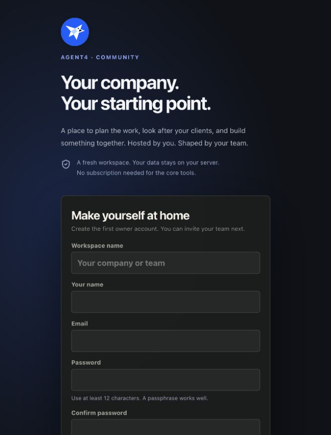
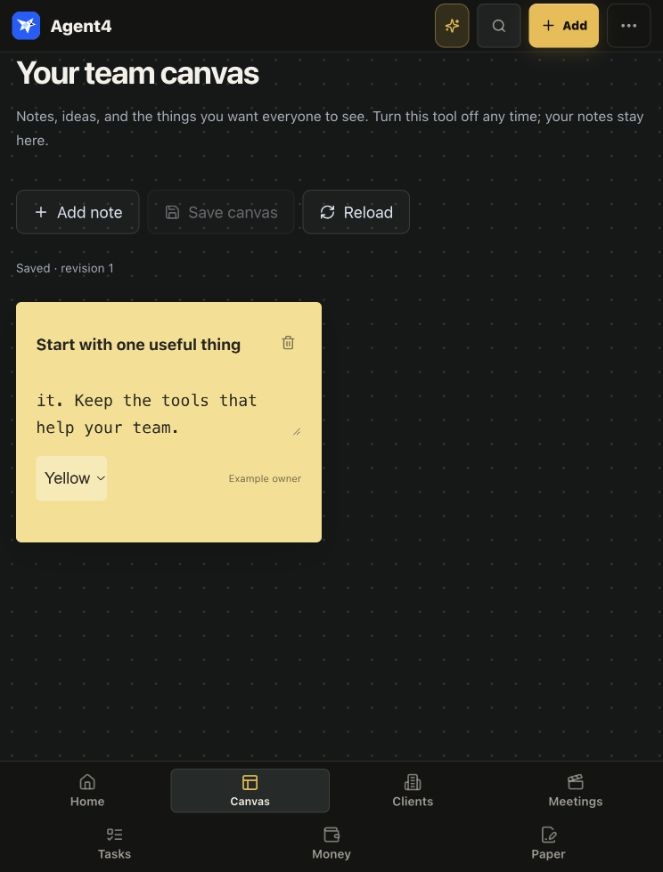

<div align="center">
  
  <h1>Agent4</h1>
  <p><strong>Your company. Your tools. Your starting point.</strong></p>
  <p>A free, self-hosted workspace for small teams building something of their own.</p>
  <p>
    <a href="https://github.com/TheRealShamsaba/agent4-community/actions/workflows/ci.yml"></a>
    <a href="LICENSE"></a>
    <a href="#get-started"></a>
  </p>
  <p><a href="#get-started">Get started</a> · <a href="docs/SELF_HOSTING.md">Hosting guide</a> · <a href="docs/CUSTOMIZATION.md">Make it yours</a> · <a href="CONTRIBUTING.md">Contribute</a></p>
</div>

Starting a company should not mean collecting a new subscription for every small thing your team needs to do.

Agent4 brings your clients, projects, tasks, meetings, money, and documents into one place. Run it on your laptop or a server you control. Start with the tools you need today, switch on more as your team grows, and change the code however you like.

This is a clean starting point: **no preloaded company records, accounts, customer information, credentials, or connections**. Your first visit creates your own workspace. There is no signup service, license server, per-seat fee, or required AI subscription.



## What you can do

| Tool | What it helps with |
| --- | --- |
| Home | See today's work, plan the week, and choose your next move. |
| Clients & projects | Keep relationships, deals, next steps, projects, sheets, and files together. |
| Tasks | Assign work, set due dates, comment, and track progress as a team. |
| Meetings | Keep personal recordings, transcripts, notes, and reviewed action items. Transcription and generated summaries need an optional service. |
| Money | Track income, expenses, recurring costs, invoices, and separate currency totals. Owner only. |
| Paperwork | Create proposals, agreements, updates, and receipts from editable templates. Owner only. |
| Canvas | Share notes and ideas. Optional, with saved revisions and conflict protection. |
| Sites | Check public website uptime, search basics, visitors, and errors. Optional; owner only. |
| Agent4 assistant | Ask built-in questions about your work. Connect a local or hosted model for open-ended conversations and suggested actions. |

Canvas and Sites start off. The other tools start on. **Turning a tool off hides it; it does not delete its work.** Turn it back on whenever you want. These preferences are separate from access permissions.

The core app works without AI, Telegram, Google, or GitHub credentials. Hosting hardware, domain names, and any paid services you choose are your costs. [See optional connections and exactly what they share.](docs/INTEGRATIONS.md)

## Get started

You need **Git and Docker with Compose v2**. On a laptop, start Docker Desktop first. On a server, install Docker Engine and the Compose plugin.

```sh
git clone https://github.com/TheRealShamsaba/agent4-community.git
cd agent4-community
./agent4.sh
```

The script builds Agent4, starts it, waits for its health check, and prints a **private setup link**. Open that link, choose your workspace name, and create your owner account with a password of at least 12 characters. Setup closes after the first owner is created.

Default address: **[localhost:8782](http://localhost:8782)**. The port is bound to your machine only. No email service is needed, and no sample clients or tasks are added.

After signing in:

1. Open the menu at the top right, then **Team access**.
2. Under **Customize this workspace**, choose the tools your team needs.
3. Create a task or add your first client.
4. Invite a teammate by entering their name and email, then share the generated link privately. Agent4 does not send invitation emails.

Invites work once, expire after seven days, and can be revoked. A new invite for the same email replaces the old one. Teammates choose their own passwords. Removing someone signs them out; the owner account is protected.

For a custom port, edit both `AGENT4_HOST_PORT` and `AGENT4_PUBLIC_URL` in `.env`, then rerun `./agent4.sh`. For a domain or remote team, follow the [HTTPS hosting guide](docs/SELF_HOSTING.md) before sharing access.

### Prefer Node without Docker?

Use **Node 24 LTS**, or Node 22.13+ on the 22.x line. Node includes SQLite; no separate database service is needed.

```sh
npm ci
npm --prefix hq ci
npm run hq:build
npm run setup
npm start
```

`npm run setup` prints your private first-use link. Open it after `npm start`. The server binds to `127.0.0.1` by default. Set `AGENT4_HOST` explicitly only when you have arranged a protected network or HTTPS proxy. [Development setup](CONTRIBUTING.md) explains the frontend dev server.

## Keep it yours

The owner's **Team access → Customize this workspace** controls the workspace name and visible tools. Canvas is included even if you prefer not to use it. Hide it today and bring it back next month; its notes stay in the database.

You can also edit the styles, replace the falcon, change document templates, add your own tools, or connect your own services. Source code is part of the product. [Customization guide →](docs/CUSTOMIZATION.md)

Agent4's public core is intended to stay useful for everyone. Personal deployments can have their own choices, branding, connections, and independent extensions. Keep those in a private deployment configuration; contribute improvements to shared features here so the two versions do not drift. [Shared-core workflow →](docs/ARCHITECTURE.md)



## Look after your workspace

```sh
./agent4.sh stop            # Stop; keep your data
./agent4.sh                 # Start or rebuild; keep your data
./agent4.sh logs            # Recent app logs
./agent4.sh backup          # Briefly stop, copy the database + files, restart
./agent4.sh reset-password  # Recover an account using access to your host
```

A Docker volume stores the database, uploaded documents, and meeting audio. Container updates keep them. Backups contain private information: copy the **whole backup directory** to private off-host storage. The backup command prints its location inside the volume. Use `docker compose cp agent4:/app/data/backups ./backups` to copy it to your machine.

Do not use `docker compose down -v` unless you intend to delete your data. Read [backup and restore instructions](docs/SELF_HOSTING.md#backups-and-restores) before updating an installation you rely on.

## A few things to know

- This is an early community release. Keep backups and test upgrades on a copy of your data.
- One installation is one trusted team. Shared clients, tasks, and Canvas are team-wide; calendars and meeting recordings are personal. Money, paperwork, site monitoring, and access management are owner-only.
- No open registration, default owner password, or hidden support account. Authentication is required.
- There is no core telemetry or required external font/CDN request. Optional connections contact only services you configure; site monitoring contacts sites you explicitly add.
- Module switches organize your workspace. They do not create additional security boundaries or prevent a permitted API user from reading retained data.
- Document templates and accounting views are starting points you can adapt to your business.

## Build it with us

Small, useful improvements are welcome: a confusing setup step, clearer wording, a fixed bug, accessibility work, or a tool that saves a small team time.

Read [CONTRIBUTING.md](CONTRIBUTING.md), browse [issues](https://github.com/TheRealShamsaba/agent4-community/issues), or start a [discussion](https://github.com/TheRealShamsaba/agent4-community/discussions). Please use fictional data in screenshots and bug reports. See [SECURITY.md](SECURITY.md) for vulnerability reporting.

**[AGPL-3.0-only](LICENSE).** You can use, study, modify, and self-host Agent4, including for your company. If you distribute modified versions or offer a modified version over a network, follow the license's source-sharing requirements. Third-party dependencies keep their own licenses; see [NOTICE](NOTICE).
